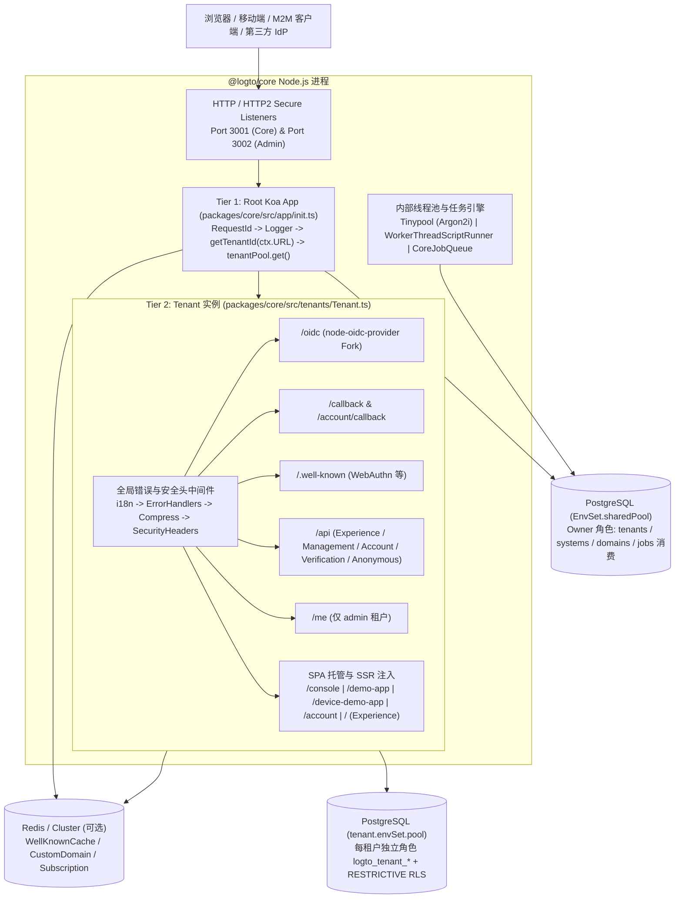

# 01 — 系统全局架构、双层 Koa 运行时与多租户模型

本文档深入说明 `@logto/core` 的进程启动序列、双端口监听、两级 Koa 应用挂载机制、多租户上下文池（`TenantPool`）、缓存一致性以及后台 Worker 线程架构。

---

## 1. 全局分层架构图

---

## 2. 启动链路与前置自检 (`index.ts` -> `main.ts`)

1. **环境变量引导**（`packages/core/src/index.ts:1-6`）：
   - 向上查找根目录 `.env` 并调用 `dotenv.config`，随后通过动态 `import('./main.js')` 加载主模块，确保 `GlobalValues` 单例初始化时能读取完整环境变量。
2. **并行初始化**（`packages/core/src/main.ts:31-73`）：
   - 初始化遥测 `appInsights.setup('core')`。
   - 创建根 `Koa` 实例（`app.proxy = EnvSet.values.trustProxyHeader`），连接管理端共享数据库池 `sharedAdminPool = await EnvSet.sharedPool`。
   - 通过 `Promise.all` 并行执行 5 项启动任务：
     1. `initI18n()`：初始化后端多语言实例。
     2. `redisCache.connect()`（`caches/index.ts:124-139`）：若配置了 `REDIS_URL`，建立单机或集群连接并验证 `PING -> PONG`。
     3. `loadConnectorFactories()`（`utils/connectors/index.ts:125-145`）：扫描 `packages/core/connectors` 下已链接/安装的连接器工厂并校验无重复 ID。
     4. `checkPreconditions(sharedAdminPool)`（`env-set/preconditions.ts:12-57`）：
        - 检查是否存在未部署的数据库迁移脚本（`getAvailableAlterations` 非空则拒绝启动，引导执行 `logto db alt deploy`）。
        - **RLS 完整性强校验**：扫描 `pg_catalog.pg_tables`，断言除 `tenants`、`systems`、`service_logs` 外的所有表均已开启 `rowsecurity = true`，防止裸表上线造成跨租户泄露。
     5. `SystemContext.shared.loadProviderConfigs(sharedAdminPool)`（`tenants/SystemContext.ts:27-72`）：从 `systems` 表加载对象存储（`storageProvider`、`experienceBlobsProvider`、`experienceZipsProvider`）、Cloudflare 自定义域名（`hostnameProvider`）及 Protected App 全局配置。
   - 注册全局 `unhandledRejection` 兜底日志，调用 `initApp(app)` 启动端口监听，并在 `EnvSet.values.isDevFeaturesEnabled` 开启时启动持久化任务队列消费者 `jobQueue.start(sharedAdminPool)`。

---

## 3. 双端口监听与两级 Koa 中间件管线

### 3.1 端口监听与 HTTP/2 (`packages/core/src/app/init.ts:112-168`)
- **同一个根 `Koa` 实例可绑定两个端口**：
  - **Core 端口（默认 `3001`，`ENDPOINT`）**：承载所有业务租户流量。
  - **Admin 端口（默认 `3002`，`ADMIN_ENDPOINT`）**：当 `!adminUrlSet.isLocalhostDisabled`（OSS 默认开启，Cloud 关闭）时额外启动监听，使访问 `:3002` 自动解析为 `admin` 租户。
- **TLS 与 HTTP/2**：配置 `HTTPS_CERT_PATH` 与 `HTTPS_KEY_PATH` 时启用 `http2.createSecureServer({ allowHTTP1: true })`，超时 `120_000ms`，并用 `WeakMap` 跟踪活跃 `ServerHttp2Session` 以便停机时主动关闭。

### 3.2 第一级：Root Koa 租户路由分发 (`packages/core/src/app/init.ts:50-110`)
1. 生成 16 位 `ctx.requestId`，挂载上下文日志 `ctx.console` 与 `koaLogger`，响应头写入 `Logto-Core-Request-Id`。
2. 域名多租户模式下，根路径 `/` 与 `/status` 直接返回 `204` 供负载均衡健康检查。
3. 调用 `getTenantId(ctx.URL)` 解析 `[tenantId, isCustomDomain]`（未命中返回 `404`）。
4. 调用 `tenantPool.get(tenantId, isCustomDomain ? ctx.URL.origin : undefined)` 获取 `Tenant` 实例（内部同步占用请求槽位 `#requestCount += 1`；若租户不存在捕获 `TenantNotFoundError` 返回 `404`）。
5. 在 `try ... finally { tenant.requestEnd(); }` 中执行 `await tenant.run(ctx, next)`。

### 3.3 第二级：Per-Tenant Koa 挂载顺序 (`packages/core/src/tenants/Tenant.ts:163-316`)
每个 `Tenant` 内部维护独立的 Koa 子应用，**挂载顺序直接决定路由优先级**（自上而下）：
1. **全局中间件链**：`koaI18next()` -> `koaErrorHandler()` -> `koaOidcErrorHandler()` -> `koaSlonikErrorHandler()` -> `koaConnectorErrorHandler()` -> `koaCompress()` -> `koaSecurityHeaders(mountedApps, id)`。
2. **`/oidc`**：`koaDeviceFlowShortcut()` + `mount('/oidc', provider)`（`node-oidc-provider` 实例）。
3. **`/callback` & `/account/callback`**：`mountCallbackRouter(app)` 处理 Apple / SAML 等 `form_post` 回调中转。
4. **`/.well-known`**：`initPublicWellKnownApis`（如 `/.well-known/webauthn`）。
5. **`/api`**：`initApis(tenantContext)`（`routes/init.ts:61-147`），外层包裹 `koaCors` 与 `koaBodyEtag`，内部挂载 5 个平级 Router：
   - `experienceRouter`（`/api/experience/*`）：终端用户认证状态机 v2。
   - `interactionRouter`（`/api/interaction/*`）：旧版 v1 交互接口及现役 `/api/interaction/consent` 授权接口。
   - `managementRouter`（`/api/*`）：管理 API（`koaAuth` Bearer JWT 验签且要求 `all` scope -> `koaReadOnlyAccess` -> `koaTenantGuard` -> `koaManagementApiHooks`）。
   - `anonymousRouter`（`/api/.well-known/*`、`/api/status`、`/api/authn/*`、`/api/saml*`、`/api/swagger.json`）。
   - `userRouter`（`/api/my-account/*`、`/api/verifications/*`）：基于 OIDC 不透明 `AccessToken`（`koaOidcAuth`）的个人中心与核身接口。
6. **自定义域名校验文件**（仅自定义域名请求）：`koaServeDomainVerificationFiles`。
7. **`admin` 租户专属挂载**：`mount('/me', initMeApis)`；非多租户（OSS）模式下额外挂载 `koaConsoleRedirectProxy` + `mount('/console', koaSpaProxy(..., 5002))`。
8. **示例应用**：`/demo-app`（5003）与 `/device-demo-app`（5005）。
9. **个人中心 SPA**：`mount('/account', compose([koaAccountCenterSsr, koaSpaProxy(..., 5004)]))`。
10. **兜底登录体验 SPA（`/`）**：`koaExperienceSecurityHeaders` -> `koaExperienceSsr` -> `koaSpaSessionGuard` -> `/consent` 自动授权链 -> `koaSpaProxy`（5001 / 静态 `dist` / 自定义 UI 对象存储）。

---

## 4. 多租户模型与 `TenantPool` 生命周期

### 4.1 租户类型与 URL 解析优先级 (`packages/core/src/utils/tenant.ts:140-186`)
- **内置租户**：
  - `default`：OSS 单租户模式下的默认业务租户。
  - `admin`：管理面租户，承载 Admin Console、`/me` 接口、Cloud M2M 客户端及跨租户管理签名密钥（业务租户的 `koaAuth` 同时信任本租户 JWKS 与 `admin` 租户 JWKS）。OSS 下 `admin` 需复用 `default` 的邮件/短信连接器时，通过 `withDefaultTenant` 安全借用 `default` 实例。
- **`getTenantId(url)` 解析顺序**：
  1. 匹配 `adminUrlSet`（如 `localhost:3002`） -> `['admin', false]`
  2. 非生产环境配置 `DEVELOPMENT_TENANT_ID` -> `[developmentTenantId, false]`
  3. 非多租户模式（`!isMultiTenancy`） -> `['default', false]`
  4. 路径多租户开发模式（`PATH_BASED_MULTI_TENANCY=1`） -> 提取首段路径 `[tenantId, false]`
  5. 查询自定义域名 `getTenantIdFromCustomDomain(url, sharedPool)` -> `[tenantId, true]`
  6. 通配符子域名匹配 `matchDomainBasedTenantId`（如 `ENDPOINT=https://*.logto.app`） -> `[subTenantId, false]`

### 4.2 `TenantContext` 与独立数据库连接池 (`packages/core/src/env-set/index.ts`)
- `Tenant.create` 使用 `EnvSet.sharedPool` 查询 `tenants` 表获取该租户专属的 PostgreSQL 角色 `db_user` 与 `db_user_password`，拼接出该租户专属 DSN 并创建独立的 Slonik `DatabasePool`（默认上限 `DATABASE_POOL_SIZE=20`，语句超时 `60000ms`）。
- 若通过自定义域名访问，`envSet.load(customDomain)` 将该实例的 `endpoint` 与 `oidc.issuer` 绑定为 `https://<custom-domain>/oidc`，因此 `TenantPool` 缓存键为 `` `${tenantId}-${customDomain ?? 'default'}` ``（同一租户的默认域名与自定义域名拥有各自独立的 `Tenant` 实例）。

### 4.3 引用计数排空与优雅停机 (`TenantPool` & `main.ts`)
- **槽位保护**：`TenantPool`（LRU 默认 `max: 100`，另设 `notFoundCache` 缓存不存在租户 60s 防刷库）在返回 `Tenant` 前同步递增 `#requestCount`。请求内派生的异步后台任务（如入队 Webhook）必须同步调用 `tenant.retainRequestSlot()` 并在 `finally` 中释放。
- **LRU 驱逐排空**：缓存项被 LRU 淘汰时，先等待 `1000ms` 宽限期让微任务队列中的并发调用完成槽位竞争，随后 `tenant.dispose()` 标记 `#disposed = true`，最多等待 `130_000ms` 直至 `#requestCount === 0` 后才安全关闭 `envSet.pool`。
- **进程优雅停机（`main.ts:95-151`，适配云容器 5s `SIGTERM -> SIGKILL` 窗口，总预算 `4.3s`）**：
  1. **排空阶段（`3500ms`）**：关闭 HTTP/HTTP2 新连接并每 `100ms` 清理空闲连接，同时停止 `jobQueue` 轮询并等待在途任务与 `#pendingEnqueues` 完成。
  2. **租约归还阶段（`300ms`）**：若排空超时，调用 `jobQueue.releaseClaimed()` 将当前 Worker 持有的未完成任务归还队列（`claimed_by = null, next_attempt_at = now()`）。
  3. **资源回收阶段（`500ms`）**：关闭所有租户池 `tenantPool.endAll()`、`EnvSet.sharedPool`、Redis 连接并刷新遥测队列。

---

## 5. 缓存层与代际防脏写回 (`packages/core/src/caches/`)

- **存储后端**：未配置 `REDIS_URL` 时 `redisCache` 自动退化为空操作（读未命中、写忽略）；配置后支持单实例与 `RedisClusterCache`（`?cluster=1`），`GET` 超时 1s、`SET`/`DEL` 超时 5s。
- **`WellKnownCache`（`caches/well-known.ts`）**：租户级高频配置缓存（TTL 30 分钟），覆盖 `sie`（登录体验）、`connectors-well-known`、`email-templates`、`resource-by-indicator`、`custom-phrases`、`signing-key-rotation-state`、`account-center`、`id-token-config`、`captcha-*` 等。
- **代际键（Generation-Guarded Write-Back，`caches/generation.ts:48-87`）**：
  - 解决“读请求先查库 -> 写请求提交新值并删缓存 -> 慢读请求把旧值写回缓存”的经典并发竞态：
  1. 读路径查库前先快照代际键 `${tenantId}:generation:${type}:${key}`。
  2. 写路径提交 DB 后调用 `invalidateWithGeneration`：先向代际键写入新随机 ID，再删除数据键。
  3. 读路径写回前、写回后双重校验代际键未变化；若写回期间代际键发生变化，立即主动 `delete` 刚写入的数据键。

---

## 6. Worker 线程池架构 (`workers/` & `libraries/script-runner/`)

1. **密码哈希池（`workers/password-encryption-worker.ts`）**：
   - 基于 `Tinypool`（`maxThreads: 2`，空闲超时 `5s`）在子线程执行 `hash-wasm` Argon2i 密码加密，避免阻塞主事件循环（注：密码校验 `argon2Verify` 当前仍在主线程同步调用 WASM）。
2. **自定义脚本执行器（`libraries/script-runner/`）**：
   - 承载 Custom JWT（`getCustomJwtClaims`）与 Actions 脚本。
   - **Cloud 模式（`IS_CLOUD=1`）**：通过 HTTPS 调用外部隔离的 Cloudflare Workers 运行时（`SCRIPT_RUNNER_ENDPOINT`，5s 超时）。
   - **自托管模式（`!isCloud`）**：使用进程内 `WorkerThreadScriptRunner`（LRU 最多 4 个 `node:worker_threads`，按 `${tenantId}:${entry}:${memoryMb}:${sha256(script)}` 隔离，单次墙钟超时 `5s`、老生代内存上限 `128MB`、单 Worker 最多复用 1000 次；超时或 OOM 立即销毁重建线程）。注意：Node `vm` + `worker_threads` 并非强安全沙箱，自托管环境下需严格管控 Management API 权限。
