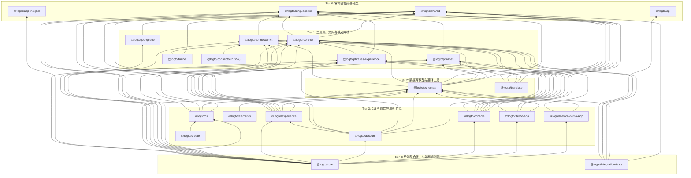

# 02 — Monorepo 包拓扑、技术栈与构建管线

仓库采用 `pnpm` Workspace 管理（见根目录 `pnpm-workspace.yaml`），共包含 **22 个核心/前端/工具/SDK 包** 与 **57 个官方连接器包**。所有包均采用原生 ESM（`"type": "module"`），TypeScript 内部相对导入统一书写 `.js` 扩展名（例如 `import { foo } from './bar.js'`，`@logto/core` 内部支持 `#src/*` Subpath Imports 映射至 `./build/*`）。

---

## 1. 五层包依赖拓扑

---

## 2. 全量工作区包速查手册

### 2.1 基础工具与领域工具包（Tier 0 & Tier 1）
| 包名 | 目录 | 构建产物 | 核心职责 |
| --- | --- | --- | --- |
| `@logto/language-kit` | `packages/toolkit/language-kit` | `lib/` (`tsc`) | 130+ BCP-47 语言标签定义、语言规范化与回退匹配、`fallback()` Zod 辅助函数 |
| `@logto/shared` | `packages/shared` | `lib/` (`tsc`) | 多入口共享库（`.` Node 端含 `GlobalValues`/`UrlSet`/`ConsoleLog`/`findPackage`；`./universal` 前后端通用 ID 生成、掩码、TtlCache；`./esm` 测试 Mock 辅助） |
| `@logto/app-insights` | `packages/app-insights` | `lib/` (`tsc`) | Azure Application Insights Node/React 遥测封装与异常上报脱敏 |
| `@logto/api` | `packages/api` | `lib/` (`tsc`) | 官方类型安全 Management API SDK（基于 `openapi-fetch`，内置 M2M Token 自动缓存与 401 刷新） |
| `@logto/connector-kit` | `packages/toolkit/connector-kit` | `lib/` (`tsc`) | 连接器接口定义（Social/Email/SMS）、Zod 配置表单 Schema、Handlebars 模板替换、SMTP 邮箱头净化、SIWE / Google One Tap 常量与工具 |
| `@logto/core-kit` | `packages/toolkit/core-kit` | `lib/` (`tsc`) + 原生 `scss/` | 核心领域规则：OIDC 标准 Scope 与 Claim 映射、密码策略校验器、重定向 URL 校验、`parseRange`、邮箱黑名单、共享 SCSS 主题变量 |
| `@logto/job-queue` | `packages/job-queue` | `lib/` (`tsc`) | 数据库无关的持久化后台任务队列引擎（并发槽跟踪、指数退避、分组断路器、优雅停机协调器） |

### 2.2 数据模型与国际化包（Tier 1 & Tier 2）
| 包名 | 目录 | 构建产物 | 核心职责 |
| --- | --- | --- | --- |
| `@logto/phrases` | `packages/phrases` | `lib/` (`tsc`) | 管理控制台、Demo App 及后端 API 错误提示语（18 种语言，`translation` + `errors` 命名空间） |
| `@logto/phrases-experience` | `packages/phrases-experience` | `lib/` (`tsc`) | 终端用户登录体验页与个人中心文案（21 种语言，强类型全量对齐） |
| `@logto/schemas` | `packages/schemas` | `lib/` + `alterations-js/` (`generate.sh` + `tsc`) | **全仓数据契约中心**：`tables/*.sql` 表结构、自动生成的 `src/db-entries/*` TS/Zod Schema、`src/foundations/jsonb-types/*` JSONB 类型守卫、种子数据与 `alterations/` 数据库迁移脚本 |
| `@logto/translate` | `packages/translate` | `lib/` (`tsc`) | `logto-translate` CLI：AST 扫描同步多语言 Key（`sync-keys`）及调用 OpenAI 自动补全翻译（`sync`） |

### 2.3 服务宿主、CLI 与测试包（Tier 3 & Tier 4）
| 包名 | 目录 | 构建产物 | 核心职责 |
| --- | --- | --- | --- |
| `@logto/core` | `packages/core` | `build/` (`tsup` + OpenAPI 拷贝) | 核心后端服务（OIDC Provider、Experience/Account/Management/`/me` API、SAML/SSO、Webhook Worker、SPA 静态/SSR 服务） |
| `@logto/cli` | `packages/cli` | `lib/` (`tsc`) | `logto` 官方运维/开发 CLI（`init`、`db seed`、`db alt`、`db config`、`connector add/link`）及被 Core 复用的连接器动态加载器 |
| `@logto/create` | `packages/create` | `index.sh` | `npm init @logto` 引导入口，透传调用 `logto init` |
| `@logto/tunnel` | `packages/tunnel` | `lib/` (`tsc`) | `logto-tunnel` 本地反向代理调试与自定义登录 UI 打包上传工具 |
| `@logto/integration-tests` | `packages/integration-tests` | `lib/` (`tsup`) | 全量 API、OIDC/SAML 协议、Experience UI 与 Console UI 端到端集成测试套件 |

### 2.4 前端应用与组件库（Tier 3）
| 包名 | 目录 | 构建产物 | 核心职责 |
| --- | --- | --- | --- |
| `@logto/experience` | `packages/experience` | `dist/` (`vite`) | 终端用户登录/注册/找回密码/MFA/Passkey/SSO/Consent/设备流 React SPA |
| `@logto/account` | `packages/account` | `dist/` (`vite`) | 终端用户个人中心（Account Center）React SPA，通过 `@experience/` 别名直接源码级复用 `experience` 组件 |
| `@logto/console` | `packages/console` | `dist/` (`generate.sh` + `vite`) | 管理控制台（同时支持自托管 OSS 模式与 Logto Cloud 多租户模式） |
| `@logto/elements` | `packages/elements` | `dist/` (`tsup`) | 基于 Lit 3 的 Shadow DOM Web Components 账户管理组件库及 `@lit/react` 封装 |
| `@logto/demo-app` | `packages/demo-app` | `dist/` (`vite`) | 内置 OIDC 交互体验预览应用（Live Preview，含 DevPanel 调试器） |
| `@logto/device-demo-app` | `packages/device-demo-app` | `dist/` (`vite`) | 内置 OAuth 2.0 Device Flow（扫码/输入设备码）体验预览应用 |

---

## 3. 关键代码生成与构建联动机制

Monorepo 中多个包通过**编译后产物（`lib/`、`dist/`）或生成脚本**被下游包消费，直接运行 `tsc` 或 `eslint` 前必须理解以下生成链：

1. **`packages/connectors/templates/sync-preset.js`（`pnpm run pnpm:devPreinstall`）**：
   - 将 `packages/connectors/templates` 中的共享配置（`tsconfig.json`、`tsup.config.ts`、`vitest.config.ts`、`package.json` 预设字段）同步写入全部 57 个 `connector-*` 包。CI `main-generated-files` 任务会检查 `git diff --exit-code -- packages/connectors`。
2. **`packages/schemas/generate.sh`（`@logto/schemas` 的 `build` / `prepack` 触发）**：
   - 编译并运行 `packages/schemas/src/gen/index.ts`，解析 `tables/*.sql` 中的 `CREATE TABLE`、`CREATE TYPE` 以及列级注释 `/* @use JsonbTypeName */`，在 `packages/schemas/src/db-entries/` 下生成每个表的 TS 类型、Zod `guard`/`createGuard`/`updateGuard` 及字段映射元数据（该目录被 `.gitignore` 忽略，必须通过 `build`/`prepack` 生成）。
3. **`packages/console/generate.sh`（`@logto/console` 的 `prepack` / `build` / `pretest` 触发）**：
   - 运行 `scripts/generate-jwt-customizer-type-definition.ts`，通过 `zod-to-ts` 将 `@logto/schemas` 中的 Custom JWT 上下文 Zod Guard 转换为字符串形式的 `.d.ts`（输出至 `src/consts/jwt-customizer-type-definition.ts`），供 Console 内的 Monaco Editor 提供实时类型提示。
4. **`packages/core` OpenAPI JSON 拷贝（`copy:apidocs`）**：
   - `packages/core/tsup.config.ts`（及 `build:test`）会将 `src/routes/**/*.openapi.json` 按原目录层级复制到 `build/routes/**/*.openapi.json`。运行时 Swagger 生成器（`routes/swagger/`）会动态扫描 `build/routes` 下的这些补充文件并与 `koaGuard` Zod 定义合并。
5. **`pnpm prepack` 全仓预构建**：
   - 在根目录运行 `pnpm prepack` 会按拓扑顺序构建所有基础包与生成文件，是解决本地跨包类型缺失（`Cannot find module '@logto/schemas'` 或新字段不存在）的标准操作。
